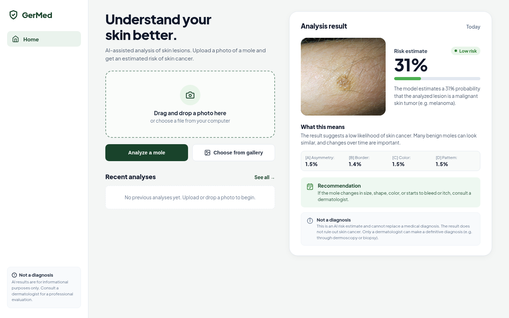

# GerMed

> **AI-Assisted Skin Lesion Screening & Clinical Explainability on Edge Devices**  
> Produced and Developed by **Oskar Gerlicz-Kowalczuk / Germaz Studio**

[](LICENSE)
[]()
[](https://huggingface.co/oskargerliczkowalczuk/germed)
[]()
[]()

**GerMed** is an open-source, offline-first medical AI application designed to estimate skin malignancy risk (Melanoma, Basal Cell Carcinoma vs. Benign Nevi) with high sensitivity. Built specifically for low-resource environments and smartphones, it operates with zero cloud dependence.

---

## Screenshot



*Real inference execution of GerMed on dermatological image sample.*

---

## Key Features

- **100% On-Device & Offline**: No cloud servers, no API tokens, no telemetry. Patient data never leaves the device.
- **Ultra-High Sensitivity (97.64%)**: Minimizes false negatives using Asymmetric Focal Loss.
- **Clinical "Thinking Mode" (ABCDE Protocol)**: Breaks down lesion geometry into Asymmetry, Border irregularity, Color variegation, and Pattern atypia.
- **Cross-Platform**:
  - **Android**: Native app (`.apk`) using `onnxruntime-android` and Google MobileNetV4 INT8 (~8.3 MB model footprint).
  - **Linux Desktop**: Lightweight, fast native WebUI package (~5.1 MB).
  - **Web**: Responsive browser interface.

---

## Downloads (Releases)

Download pre-built production releases from the **[Releases](https://github.com/germaz-studio/germed/releases)** tab:

- **Android APK**: `GerMed-Mobile-v1.0.0.apk` (Install on any Android 8.0+ device).
- **Linux Native App**: `germed-v1.0.0-linux-x86_64.tar.gz` (Extract and run `./germed`).

---

## Running on Linux Desktop

```bash
# Extract package
tar -xzf germed-v1.0.0-linux-x86_64.tar.gz
cd germed

# Run standalone application
./germed
```

Requirements: Python 3 with `onnxruntime` and `pillow`.

---

## Android Project Structure

The native Android app source code is located in the `android/` directory:
- Native Kotlin implementation with `WebViewAssetLoader` for secure local asset delivery.
- Direct JNI bindings to Microsoft ONNX Runtime Android for real-time mobile inference (< 40ms on modern ARM chips).

---

## Medical Disclaimer

**GerMed** is intended strictly as an assistive triage aid and educational tool. It is **NOT** a certified diagnostic medical device. Any suspicious, enlarging, bleeding, or itching mole must always be examined in person by a qualified dermatologist or medical practitioner.

---

## License

GNU General Public License v3.0 (GPLv3).  
Copyright (c) 2026 Oskar Gerlicz-Kowalczuk / Germaz Studio.
